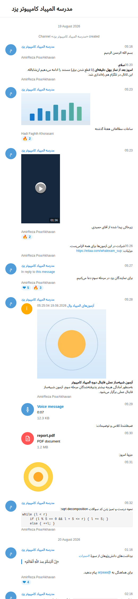

# eitaa-export

[English](README.md) | **فارسی**

> رابط خط فرمان و مستندات پیش‌فرض انگلیسی است؛ نسخهٔ فارسی همین صفحه است.

برون‌ریزی کامل **تاریخچهٔ کانال، گروه، سوپرگروه یا گفت‌وگوی شخصی ایتا** به یک آرشیو HTML
با ظاهر و ساختار خروجی «Telegram Desktop»؛ همان چیدمانی که در نمونهٔ `messages.html`،
`css/style.css`، `js/script.js`، `photos/`، `video_files/` و `stickers/` دیده می‌شود.



این ابزار از کتابخانهٔ [`eitaa-cli`](https://github.com/MokhtariF1/eitaa-cli) استفاده می‌کند
و مستقیماً با API وب ایتا (TL over HTTPS) کار می‌کند؛ نه Selenium لازم دارد و نه مرورگر.

---

## چه چیزی ساخته می‌شود؟

```
export_<name>/
├── messages.html
├── css/
│   └── style.css
├── js/
│   └── script.js
├── images/                  # آیکون‌های رابط کاربری (نسخهٔ ۱x و ۲x)
├── photos/
│   ├── photo_1@19-08-2026_12-24-16.jpg
│   └── photo_1@19-08-2026_12-24-16_thumb.jpg
├── video_files/
│   ├── video_1@20-08-2026_18-24-45.mp4
│   └── video_1@20-08-2026_18-24-45.mp4_thumb.jpg
├── voice_messages/
├── files/
└── stickers/
```

- تمام پیام‌ها، پیام‌های سرویس (ساخت کانال، تغییر عنوان، عضویت و…)، ریپلای‌ها،
  فورواردها، امضای نویسنده و ری‌اکشن‌ها (اگر سرور برگرداند) رندر می‌شوند.
- رسانه‌ها دانلود می‌شوند: عکس (همراه با نسخهٔ بندانگشتی)، ویدیو، ویس، فایل،
  استیکر و گیف.
- تاریخ‌ها به وقت تهران (قابل تغییر) نمایش داده می‌شوند؛ دقیقاً با همان قالب
  `19 August 2026` و `05:16` و `title="19.08.2026 05:16:04 UTC+03:30"`.
- نام فرستنده و تصویر پروفایل او **قابل کلیک** است و پروفایلش را در ایتا باز می‌کند
  (`https://eitaa.com/<username>`)، اگر شناسهٔ کاربردی موجود باشد.
- ارجاع به پیام (`#go_to_message…`) و اسکرول نرم، مثل خروجی تلگرام کار می‌کند.
- تاریخچه به‌صورت صفحه‌به‌صفحه دریافت می‌شود؛ برای کانال‌های چند هزار پیامی هم
  مناسب است و در صورت قطع شدن، اجرای مجدد فایل‌های موجود را ادامه می‌دهد.
- برای هر فایل دانلودشده یک **نوار پیشرفت جداگانه** با درصد، حجم، سرعت و زمان
  باقی‌مانده نمایش داده می‌شود که تا ۱۰۰٪ پر می‌شود؛ یک نوار کلی هم برای همهٔ
  فایل‌ها وجود دارد. رابط خط فرمان کاملاً انگلیسی است.

---

## نصب

`eitaa-cli` هنوز روی PyPI منتشر نشده است؛ ابتدا آن را از GitHub نصب کنید:

```bash
git clone https://github.com/MokhtariF1/eitaa-cli.git
cd eitaa-cli
python3 -m venv .venv
source .venv/bin/activate
python -m pip install -U pip
pip install -e '.[media]'
```

سپس در همین محیط:

```bash
cd /path/to/eitaa-export
pip install .
```

یا برای توسعه:

```bash
pip install -e '.[dev]'
```

پیش‌نیاز: Python 3.11 یا بالاتر.

> اگر `eitaa-cli` را از قبل نصب کرده‌اید و نمی‌خواهید pip دوباره آن را از GitHub
> بگیرد، از `pip install . --no-deps` استفاده کنید.

---

## ورود

یک‌بار با حساب ایتای خود وارد شوید. کد تأیید به شمارهٔ شما فرستاده می‌شود:

```bash
eitaa-export login +989121234567
```

نشست در `~/.config/eitaa-cli/sessions.json` با دسترسی `0600` ذخیره می‌شود.
اگر از قبل با `eitaa auth login` وارد شده‌اید، همان نشست استفاده می‌شود.

برای چند حساب:

```bash
eitaa-export login +989121234567 --profile personal
eitaa-export export @channel --profile personal
```

---

## استفاده

```bash
# لینک کانال یا گروه
eitaa-export export https://eitaa.com/yazd_oi -o yazd_export

# با نام کاربری
eitaa-export @yazd_oi

# لینک عضویت (اگر عضو نیستید، با --join عضو می‌شود)
eitaa-export "https://eitaa.com/+AbCdEf123" --join

# با شناسهٔ کامل (پیشنهاد می‌شود؛ پایدارتر از نام کاربری است)
eitaa-export channel:123456789:987654321
eitaa-export chat:123456789
eitaa-export user:123456789:987654321

# فقط ۲۰۰ پیام آخر، بدون رسانه
eitaa-export @yazd_oi --limit 200 --no-media -o last200

# از تاریخ مشخص
eitaa-export @yazd_oi --since 2026-08-01 --until 2026-09-01
```

اگر اولین آرگومان یکی از دستورها نباشد، به‌صورت خودکار `export` در نظر گرفته می‌شود؛
یعنی `eitaa-export @channel` همان `eitaa-export export @channel` است.

### پیدا کردن شناسهٔ درست

```bash
eitaa-export chats --limit 100
```

ستون `REFERENCE` را دقیقاً همان‌طور که هست به دستور `export` بدهید:

```
KIND        TITLE                        USERNAME        REFERENCE
channel     مدرسه المپیاد کامپیوتر یزد    @yazd_oi        channel:87197708:1234567890
```

برای گفت‌وگوهای شخصی، `user:ID:ACCESS_HASH` پایدارترین شکل است. یک شناسهٔ عددی
تنها کافی نیست، چون ایتا برای کاربران و کانال‌ها `access_hash` هم لازم دارد.

### گزینه‌ها

| گزینه | کار |
|---|---|
| `-o, --output DIR` | پوشهٔ خروجی (پیش‌فرض `export_<username>`) |
| `--limit N` | فقط N پیام آخر |
| `--since` / `--until` | فیلتر تاریخ (`YYYY-MM-DD` یا ISO 8601) |
| `--timezone` | منطقهٔ زمانی خروجی (پیش‌فرض `Asia/Tehran`) |
| `--no-media` | فقط متن؛ هیچ رسانه‌ای دانلود نمی‌شود |
| `--no-stickers` | استیکرها دانلود نشوند |
| `--no-created` | پیام «Channel/Group created» اضافه نشود |
| `--join` | در صورت نیاز، با لینک عضویت به گروه/کانال بپیوند |
| `--page-size` | اندازهٔ هر صفحهٔ دریافت (پیش‌فرض ۱۰۰) |
| `--profile` | نام پروفایل ذخیره‌شده |
| `-q, --quiet` | نمایش ندادن پیشرفت |

---

## استفاده به‌عنوان کتابخانه

```python
import asyncio
from pathlib import Path

from eitaa_cli import EitaaClient
from eitaa_export import ExportOptions, Exporter


async def main() -> None:
    client = await EitaaClient.create(require_auth=True)
    async with client:
        exporter = Exporter(
            client,
            ExportOptions(
                output=Path("yazd_export"),
                include_media=True,
                timezone="Asia/Tehran",
            ),
        )
        stats = await exporter.export("https://eitaa.com/yazd_oi")
        print(stats.messages, "messages,", stats.photos, "photos")


asyncio.run(main())
```

---

## نکات مهم و محدودیت‌ها

- **دسترسی:** تنها چیزهایی قابل دریافت است که حساب شما اجازهٔ دیدنشان را دارد.
  برای کانال/گروه خصوصی باید عضو باشید. این ابزار از حساب کاربری استفاده می‌کند،
  نه ربات؛ ربات‌های ایتا تاریخچهٔ کانال‌های دیگر را نمی‌بینند.
- **تاریخچهٔ کامل:** اگر کانال برای اعضای عادی تاریخچه را محدود کرده باشد یا شما
  تازه عضو شده باشید، سرور فقط همان بازهٔ مجاز را برمی‌گرداند. ابزار هر چه سرور
  بدهد ذخیره می‌کند و در ابتدا هشدار می‌دهد اگر نتواند جزئیات گفت‌وگو را بگیرد.
- **سرعت و محدودیت:** دریافت صفحه‌به‌صفحه و دانلود تک‌به‌تک انجام می‌شود تا به
  محدودیت‌های ایتا برنخوریم. در صورت خطای موقت، بعد از چند دقیقه دوباره اجرا کنید؛
  فایل‌های کامل‌شده دوباره دانلود نمی‌شوند.
- **رسانه‌ها:** لینک فایل‌ها در ایتا موقتی است؛ بهتر است بلافاصله پس از دریافت
  تاریخچه، رسانه‌ها را هم دانلود کنید. اگر یک فایل خراب/منقضی باشد، بقیهٔ خروجی
  متوقف نمی‌شود و آن پیام با پیام «Unavailable» رندر می‌شود.
- **ری‌اکشن‌ها:** لایهٔ ۱۳۵ API ایتا فیلد ری‌اکشن ندارد؛ اگر سرور در آینده آن را
  برگرداند، قالب خروجی آماده است.
- **تاریخ ساخت کانال:** اگر سرور پیام سرویس «ساخته شد» را برنگرداند، ابزار یک
  پیام سرویس بر اساس تاریخ ساخت خود کانال اضافه می‌کند (با `--no-created` خاموش
  می‌شود).
- **ورود دو مرحله‌ای:** اگر روی حساب ایتای شما رمز دومرحله‌ای فعال است، نسخهٔ
  فعلی `eitaa-cli` ورود با رمز را پشتیبانی نمی‌کند؛ از نشست موجود یا حسابی که
  رمز دومرحله‌ای ندارد استفاده کنید.
- **حریم خصوصی:** خروجی شامل متن و رسانهٔ خصوصی است. آن را جای امن نگه دارید و
  به کسی که مجاز نیست ندهید.
- **مسئولیت:** فقط گفت‌وگوها/کانال‌هایی را استخراج کنید که مالک آن‌ها هستید یا
  اجازهٔ صریح دارید. رعایت قوانین ایتا و حقوق نویسندگان بر عهدهٔ شماست.

---

## عیب‌یابی

| خطا | راه‌حل |
|---|---|
| `Not signed in` | `eitaa-export login +98...` |
| `Peer not found` | از `eitaa-export chats` شناسهٔ `channel:…` یا `user:…` را بردارید |
| `FLOOD_WAIT` | چند دقیقه صبر کنید؛ زمان دقیق در پیام خطا می‌آید |
| فایل‌ها دانلود نمی‌شوند | مطمئن شوید عضو هستید و فایل حذف/منقضی نشده است |
| زمان‌ها اشتباه‌اند | `--timezone` را تنظیم کنید (پیش‌فرض `Asia/Tehran`) |
| HTML بدون تصویر | پوشهٔ `images/` را همراه `css/` و `js/` کپی کنید |

---

## نوارهای پیشرفت

هنگام دانلود، دو نوار می‌بینید:

- **All files** — حجم کل و درصد کل فایل‌ها
- **نام فایل** — پیشرفت همان فایل، با درصد، حجم، سرعت و زمان تقریبی

فایل‌های از قبل کامل‌شده با وضعیت `cached` و ۱۰۰٪ نشان داده می‌شوند. برای خاموش
کردن نوارها از `--quiet` استفاده کنید. اگر خروجی را به فایل/لوله بفرستید، به‌جای
نوار زنده، خطوط سادهٔ درصد چاپ می‌شود.

---

## توسعه و تست

```bash
pip install -e '.[dev]'
pytest -q
ruff check src tests scripts
```

برای ساخت یک خروجی نمونهٔ آفلاین (بدون نیاز به حساب ایتا):

```bash
python scripts/build_demo.py
# سپس demo/messages.html را در مرورگر باز کنید
```

---

## مجوز

MIT
