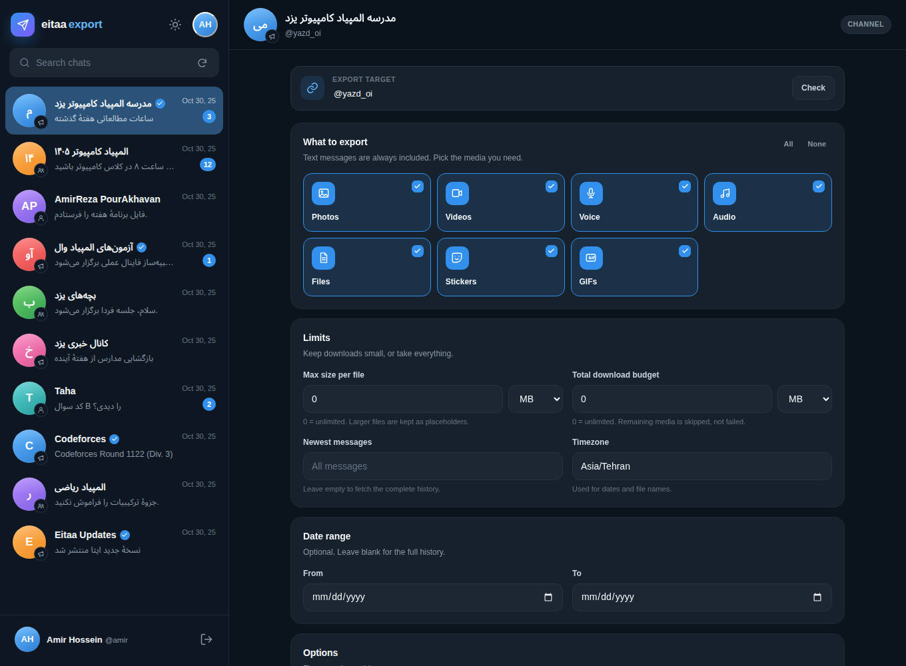
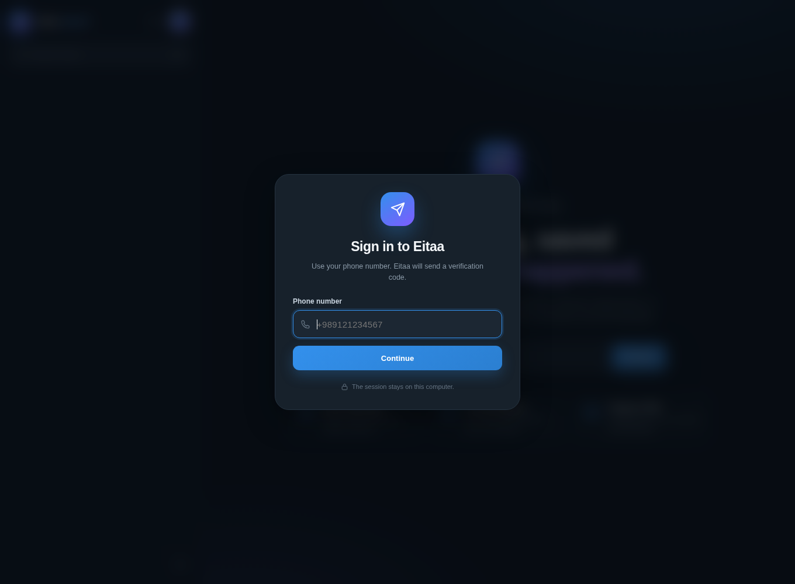
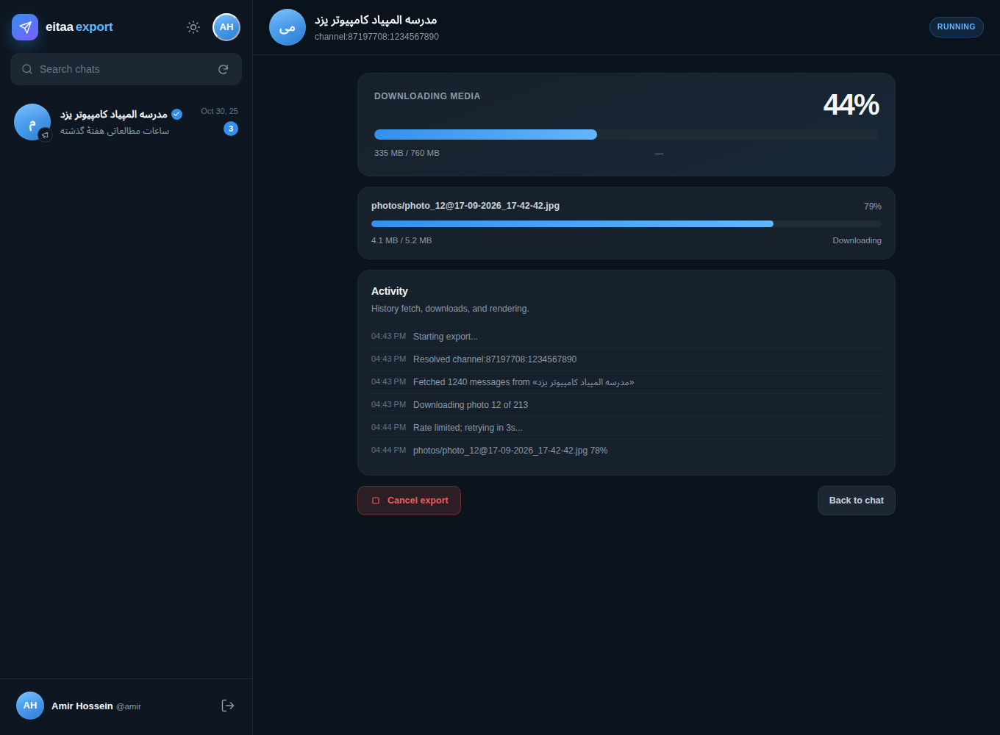

# eitaa-export

**English** | [فارسی](README.fa.md)

Export the **complete history of an Eitaa channel, group, supergroup, or direct chat** into a
Telegram-Desktop-style HTML archive: `messages.html`, `css/style.css`, `js/script.js`,
`photos/`, `video_files/`, `voice_messages/`, `files/`, and `stickers/`.


The exporter is built on [`eitaa-cli`](https://github.com/MokhtariF1/eitaa-cli) and talks
directly to Eitaa's TL-over-HTTPS web API. It does not use a browser, Selenium, or browser
cookies.

---

## Features

- **Full history**, fetched page by page with resumable media downloads.
- **Telegram-style UI**: date separators, service events, replies, forwards, author
  signatures, reactions (when the server provides them), rich text entities, code blocks,
  blockquotes, hashtags, mentions, and links.
- **Media**: photos with thumbnails, videos, voice messages, audio, documents, GIFs, and
  stickers. Telegram-compatible filenames such as
  `photo_1@19-08-2026_12-24-16.jpg` and `video_1@20-08-2026_18-24-45.mp4_thumb.jpg`.
- **Per-file progress bars**: every download shows a 0→100% bar with size, speed, and ETA,
  plus an overall bar for the whole export.
- **Clickable profiles**: sender names and avatars open the peer in Eitaa
  (`https://eitaa.com/<username>`), with a numeric-ID fallback when no username is available.
- **Invite links**: `https://eitaa.com/+…` and `https://eitaa.com/joinchat/…` are supported.
  Use `--join` if the account is not a member yet.
- **Filters**: newest N messages, date ranges, text-only export, and sticker toggles.
- **Telegram-style web GUI** with sign-in, chat list, media filters, size limits, and live progress.
- **English CLI** with clear errors and flood-wait guidance.
- **Offline demo** and a test suite that do not require an Eitaa account.

---

## Output layout

```text
export_<name>/
├── messages.html
├── css/
│   └── style.css
├── js/
│   └── script.js
├── images/                  # UI icons, 1x and 2x
├── photos/
│   ├── photo_1@19-08-2026_12-24-16.jpg
│   └── photo_1@19-08-2026_12-24-16_thumb.jpg
├── video_files/
│   ├── video_1@20-08-2026_18-24-45.mp4
│   └── video_1@20-08-2026_18-24-45.mp4_thumb.jpg
├── voice_messages/
├── files/
└── stickers/
```

Folders are created only when they contain files. Existing complete files are reused on a
re-run.

---

## Requirements

- Python **3.11+**
- An Eitaa account with access to the chat you want to export
- [`eitaa-cli`](https://github.com/MokhtariF1/eitaa-cli)

---

## Installation

`eitaa-cli` is not on PyPI yet. Install it from GitHub first:

```bash
git clone https://github.com/MokhtariF1/eitaa-cli.git
cd eitaa-cli
python3 -m venv .venv
source .venv/bin/activate
python -m pip install -U pip
pip install -e '.[media]'
```

Then install this project in the same environment:

```bash
cd /path/to/eitaa-export
pip install .
```

For development:

```bash
pip install -e '.[dev]'
```

> If `eitaa-cli` is already installed and you do not want pip to fetch it from GitHub again,
> use `pip install . --no-deps`.

---

## Sign in

Sign in once with your Eitaa account. The verification code is sent by Eitaa:

```bash
eitaa-export login +989121234567
```

The session is stored at `~/.config/eitaa-cli/sessions.json` with owner-only permissions
(`0600`). If you already signed in with `eitaa auth login`, that session is reused.

Multiple accounts:

```bash
eitaa-export login +989121234567 --profile personal
eitaa-export export @channel --profile personal
```

---

## Graphical interface

```bash
eitaa-export gui
```

This starts a local web app at **http://127.0.0.1:8765** and opens it in your
browser. It is designed like Telegram Desktop: dark and light themes, a chat
sidebar, a profile menu, and a focused export panel.

- **Sign in from the browser** with your phone number and the one-time code.
  If a saved session exists, the app opens directly on your chats.
- **Browse chats** with search, unread badges, avatars, and last-message previews.
- **Select a chat** or paste any channel link, invite link, `@username`, or peer ID.
- **Choose media types**: photos, videos, voice, audio, files, stickers, GIFs.
  Text messages are always included.
- **Set limits**: maximum size per file, total download budget, newest N messages,
  and an optional date range.
- **Watch progress**: an overall bar plus a per-file bar with percentage, size,
  speed, and ETA. The job survives page refreshes while the server is running.
- **Open the result** directly in the browser through the built-in archive route.
- **Sign out** from the profile menu; the local session is removed.



<details>
<summary>More screenshots</summary>





</details>

Useful GUI options:

| Option | Meaning |
|---|---|
| `--host` | Bind address (default `127.0.0.1`; keep it local) |
| `--port` | Port (default `8765`; `0` chooses a free port) |
| `--output-root` | Where archives are stored (default `~/EitaaExports`) |
| `--no-browser` | Do not open a browser automatically |
| `--profile` | Use a specific `eitaa-cli` profile |
| `--quiet` | Quiet HTTP request logs |

The GUI is a local server, not a cloud service: it binds to loopback by default
and never exposes your session token to the page.

---

## Usage

```bash
# Channel or group link
eitaa-export export https://eitaa.com/yazd_oi -o yazd_export

# Username
eitaa-export @yazd_oi

# Invite link; join first if needed
eitaa-export "https://eitaa.com/+AbCdEf123" --join

# Reusable references (recommended: more stable than usernames)
eitaa-export channel:123456789:987654321
eitaa-export chat:123456789
eitaa-export user:123456789:987654321

# Newest 200 messages, text only
eitaa-export @yazd_oi --limit 200 --no-media -o last200

# Date range
eitaa-export @yazd_oi --since 2026-08-01 --until 2026-09-01
```

If the first argument is not a known command, `export` is used automatically, so
`eitaa-export @channel` means `eitaa-export export @channel`.

### Finding the right reference

```bash
eitaa-export chats --limit 100
```

Pass the `REFERENCE` column to `export` unchanged:

```text
KIND        TITLE                        USERNAME        REFERENCE
channel     Computer Olympiad School     @yazd_oi        channel:87197708:1234567890
```

For direct chats, `user:ID:ACCESS_HASH` is the most reliable form. A bare numeric ID is not
enough because Eitaa requires an `access_hash` for users and channels.

### Options

| Option | Meaning |
|---|---|
| `-o, --output DIR` | Output directory (default: `export_<username>`) |
| `--limit N` | Only the newest N messages |
| `--since` / `--until` | Date filter (`YYYY-MM-DD` or ISO 8601) |
| `--timezone` | Timezone used in the archive (default: `Asia/Tehran`) |
| `--no-media` | Text only; do not download any media |
| `--no-stickers` | Skip stickers |
| `--no-created` | Do not add a synthetic “Channel/Group created” event |
| `--join` | Join the group/channel through an invite link if needed |
| `--page-size` | Messages per history request (default: 100) |
| `--profile` | Stored `eitaa-cli` profile name |
| `-q, --quiet` | Disable progress output |

---

## Progress bars

While media is downloading, the terminal shows:

- **All files** — total size and overall percentage.
- **Current file** — a bar that fills from 0% to 100%, with the downloaded size, transfer
  speed, and estimated time remaining.

Completed files stay visible for one more file so the 100% state is readable; files already
complete are marked `cached`. If `rich` is unavailable or stderr is not a terminal, the
exporter falls back to simple percentage lines. `--quiet` suppresses progress entirely.

---

## Library usage

```python
import asyncio
from pathlib import Path

from eitaa_cli import EitaaClient
from eitaa_export import ExportOptions, Exporter


async def main() -> None:
    client = await EitaaClient.create(require_auth=True)
    async with client:
        exporter = Exporter(
            client,
            ExportOptions(
                output=Path("yazd_export"),
                include_media=True,
                timezone="Asia/Tehran",
            ),
        )
        stats = await exporter.export("https://eitaa.com/yazd_oi")
        print(stats.messages, "messages,", stats.photos, "photos")


asyncio.run(main())
```

---

## How it works

1. Resolve the peer (username, link, invite link, or typed reference).
2. Fetch `messages.getHistory` pages and collect users/chats seen in each response.
3. Normalize messages, service events, text entities, forwards, replies, and attachments.
4. Plan deterministic Telegram-compatible filenames and download media in chunks.
5. Render `messages.html` and copy the CSS, JS, and icon assets.

---

## Limitations

- **Access:** the exporter can only read what your account is allowed to read. Private
  channels/groups require membership. Eitaa bots cannot read arbitrary channel history, so
  this tool uses a user session.
- **Full history:** if a channel restricts history for regular members, the server returns
  only the allowed range. The exporter saves what the server provides and warns when chat
  metadata cannot be loaded.
- **Temporary media:** Eitaa file references can expire. Export and download promptly. A
  broken file does not abort the whole export; the message is rendered as “Unavailable”.
- **Reactions:** API layer 135 has no reaction field. The HTML template is ready if the
  server starts returning reactions.
- **Two-step login:** the current `eitaa-cli` does not support password/cloud-password
  login. Use an existing session or an account without two-step verification.
- **GUI security:** the GUI is intended for local use. Keep `--host 127.0.0.1`
  unless you understand how to protect a network-exposed API.
- **Privacy:** an export contains private text and media. Store it securely.
- **Responsibility:** export only chats you own or are authorized to access. You are
  responsible for complying with Eitaa's terms and with the rights of message authors.
- **Not byte-identical to Telegram:** the archive reproduces Telegram Desktop's layout,
  classes, and interactions, but it is an independent implementation.

---

## Troubleshooting

| Problem | Fix |
|---|---|
| `Not signed in` | `eitaa-export login +98...` |
| `Peer not found` | Use `eitaa-export chats` and copy the full `channel:…`/`user:…` reference |
| `FLOOD_WAIT` | Wait for the server-provided delay; the exporter retries automatically when possible |
| Media files are missing | Confirm membership; the file may have been deleted or expired |
| Wrong times | Pass the correct `--timezone` |
| HTML has no images | Keep the `images/`, `css/`, and `js/` folders next to `messages.html` |
| Progress bars do not render | Use an interactive terminal; redirected output uses plain lines |
| GUI port is busy | Run `eitaa-export gui --port 0` to pick a free port |
| GUI is not reachable | Confirm the server is running and open the printed URL exactly |
| Chat list is empty | Sign in again, or use a saved profile with `--profile` |

---

## Development and tests

```bash
pip install -e '.[dev]'
pytest -q
ruff check src tests scripts
mypy --ignore-missing-imports src/eitaa_export
```

Build an offline demo without an Eitaa account:

```bash
python scripts/build_demo.py
# open demo/messages.html in a browser
```

The demo data is Persian to mirror a real Eitaa channel; all program output and the default
documentation are English.

---

## License

MIT
